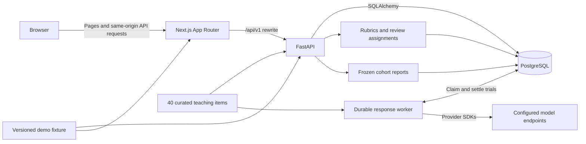

# System architecture

The frontend uses Next.js, TypeScript, Tailwind CSS, a shadcn-style Radix Button, Framer Motion, Lucide, and Recharts. App Router serves the landing page, workspace shell, module pages, and account screen. An interactive SVG depicts two analyses of a sentence. CSS variables control the theme across both areas. The dashboard and lab access data through `lib/api.ts`. They use the shared synthetic fixture when the API is unreachable, with a visible data-source indicator. The private workspace always queries the API.

FastAPI owns validation and persistence. SQLAlchemy provides request-scoped sessions and Alembic owns schema changes. Docker Compose runs PostgreSQL. SQLite is available for local evaluation without a database service. The same migration supports both. No external model services or credentials are required for the demo.

## Persistence

| Table | Purpose |
| --- | --- |
| `users`, `sessions` | Researcher identity, role field, and revocable, expiring sessions |
| `datasets`, `dataset_items` | Owner, immutable version, provenance, active archive flag, stable keys, stimuli, and references |
| `prompts` | Owner-scoped template version and linguistic dimension |
| `model_snapshots` | Provider and exact model identifier |
| `experiments` | Owner, run kind, cancellation flag, state, repetitions, and experiment manifest |
| `responses` | One durable task per experiment, item, model and trial, with exact prompt, queue state, lease, raw text, validated JSON, metadata, and retry evidence |
| `evaluations` | Response, human reviewer when applicable, rubric version, criterion, method, score, and evidence |
| `reports` | Experiment and report specification |
| `rubric_versions`, `assessment_jobs`, `assessment_attempts` | Immutable rubric versions, queued evaluations, exact judge prompts, and results per attempt |
| `review_assignments`, `review_decisions` | Reviewer ownership, blinded input snapshots with an exact response hash, optimistic draft revisions, final grades, and adjudication history |
| `response_errors`, `research_snapshots`, `research_audit` | Versioned evidence annotations, frozen comparison and consistency cohorts, and mutation history |
| `model_providers` | Per-account enablement, encrypted credential, default model, and parameters |
| `research_quota` | Database-enforced per-account windows for submissions, configuration, and mutations |

Migration `0002` adds queue and provider metadata to the Phase 1 schema. Every analyzer writes the same experiment, dataset-item, and trial records used by batches. The submission transaction freezes selected inputs, prompt text and model parameters. The worker claims pending trials using a lease and claim token, releases the database transaction while calling a provider, and commits the result under the same claim. An expired lease can be recovered. Cancellation stops queued work and preserves results already returned. Manual retry stores the previous raw and parsed results before resubmission.

The role field distinguishes researchers, reviewers, and administrators. Experiment routes enforce ownership and task compatibility. Review routes check assignment ownership and adjudication privileges. Data and prompt edits create new versions, while previous experiments retain their saved references. Provider credentials are resolved on each request from the account setting or server environment and are excluded from manifests.

## API

Success bodies use `{"data": ...}`. API errors use `{"error":{"code":"...","message":"..."}}`. The OpenAPI interface is at `http://localhost:8000/docs`.

| Endpoint | Purpose |
| --- | --- |
| `GET /health/live` | API process liveness |
| `GET /health/ready` | Database connectivity and core migrated table |
| `GET /api/v1/demo/overview` | Synthetic metrics, activity, and examples |
| `GET /api/v1/demo/examples/{dimension}` | Fixture annotation for a selected task |
| `POST /api/v1/auth/register` | Create and sign in a researcher |
| `POST /api/v1/auth/login` | Verify credentials and issue a fresh session |
| `GET /api/v1/auth/me` | Return the current profile |
| `POST /api/v1/auth/logout` | Revoke the active session |
| `GET /api/v1/workspace/overview` | Counts and recent experiments scoped to the signed-in owner |
| `GET /api/v1/providers`, `PUT /api/v1/providers/{provider}` | List and update provider settings |
| `POST /api/v1/providers/{provider}/test` or `/models` | Test saved credentials and discover model IDs |
| `GET /api/v1/models` | Demo model and configured live model choices |
| `POST /api/v1/linguistic/{dimension}` | Queue a single analysis for one of the four tasks |
| `GET/POST /api/v1/datasets`, `GET/PUT/DELETE /api/v1/datasets/{id}` | List, create, read, version or archive owner-scoped datasets |
| `POST /api/v1/datasets/import`, `POST /api/v1/datasets/{id}/duplicate`, `GET /api/v1/datasets/{id}/export` | Import, duplicate, and export datasets |
| `GET /api/v1/dataset-items`, `POST /api/v1/dataset-items/preview-import` | Read stimuli or validate an import for editing |
| `GET/POST /api/v1/prompts`, `POST /api/v1/prompts/{id}/preview` | List versions, save a new version, or render and inspect its schema |
| `GET/POST /api/v1/experiments` | List and submit batch experiments |
| `GET /api/v1/experiment-runs/{id}`, `POST /api/v1/experiment-runs/{id}/cancel` or `/retry` | Inspect state and trial progress, cancel or retry |
| `GET /api/v1/history`, `GET/DELETE /api/v1/responses/{id}` | Filter, inspect or hide saved responses |
| `POST /api/v1/responses/{id}/rerun` or `/test-rule` | Repeat the exact saved analysis or apply its programmatic phonology rule |
| `GET /api/v1/evaluations`, `POST /api/v1/evaluations/automated`, `GET /api/v1/evaluations/{id}`, `POST /api/v1/evaluations/{id}/retry` | Queue, inspect, list, and retry automated assessments |
| `GET/POST /api/v1/evaluations/rubrics`, `GET /api/v1/evaluations/audit` | Version rubrics and inspect research mutations |
| `GET/POST /api/v1/review-assignments`, `GET/PUT /api/v1/human-reviews/{id}` | Authorize, open, draft, and submit human reviews |
| `GET /api/v1/review-consensus`, `/agreement`, `/disputes`, `POST /api/v1/review-consensus/adjudicate` | Inspect votes, kappa, disagreements, and administrative decisions |
| `GET /api/v1/errors`, `/errors/categories`, `GET/PATCH /api/v1/errors/{id}` | Filter annotations, read the original assessed response, and review annotations |
| `GET/POST /api/v1/model-comparisons`, `GET/POST /api/v1/consistency` | Calculate or save cohort results and list saved snapshots |
| `POST /api/v1/leaderboard`, `/analytics`, `/statistics`, `GET /api/v1/analytics/options`, `/analytics/dashboard` | Matched rankings, filtered statistics, metadata, and dashboard aggregates |
| `GET/POST /api/v1/reports`, `GET /api/v1/reports/{id}`, `/reports/export/{id}?format=pdf\|csv\|json` | Freeze, preview, list, and securely export scientific reports |

Passwords use Argon2id. The database holds only digests of high-entropy session tokens. The API sends an HttpOnly, SameSite=Lax cookie and checks the configured browser Origin for writes. Set `SECURE_COOKIE=true` under HTTPS. API requests are bounded to 1 MB and dataset files to 750 KB. Live SDK calls use bounded timeouts and retries. User-supplied inputs and model results are rendered as text or validated SVG nodes. Production rollout also needs ingress abuse controls, quota planning, account recovery, and session cleanup.

Phase 3 reuses the response queue, provider layer, owner-scoped queries, and tree renderer. Rubric scores reference the version and attempt or human assignment that produced them. Report generation freezes a JSON specification referencing settled experiments and produces PDF, CSV, or JSON on authorized download. See [methodology and formulas](phase-3.md).
