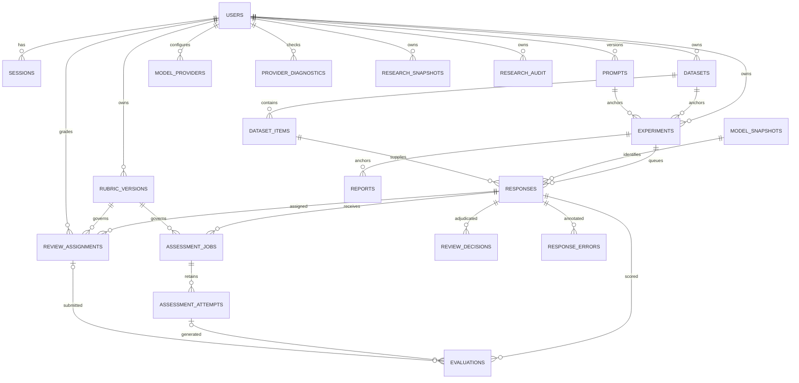

# Database design

Models in `backend/app/models.py` and `backend/app/evaluation_models.py` define these relationships. The diagram focuses on the experiment and evidence paths.

A dataset name and version belong to one owner. Item keys are unique per dataset, and provider plus identifier uniquely identifies a model snapshot. A trial is unique per experiment, item, model, and trial number. A mixed-dataset run stores all datasets and prompts in its manifest. Each response retains the exact rendered prompt and effective settings.

Evaluation rows store normalized criterion scores with a check constraint from zero to one. The assessment attempt and rubric identify how a score was obtained. Missing grades have no criterion row. A review is unique by response, rubric, reviewer and exact text hash. Submitted records are immutable in the application. Adjudication records the exact evaluated review IDs. `reports` holds the frozen comparison, trial observations and inference summaries. Historical revisions remain readable.

`authentication_quota` stores fixed-window counts keyed by a digest of the rate scope. `research_quota` counts actions per owner and operation. A diagnostic has one row per owner and provider. Migration `0005` adds these diagnostics and authentication counters. [Migration procedure](deployment-guide.md)
