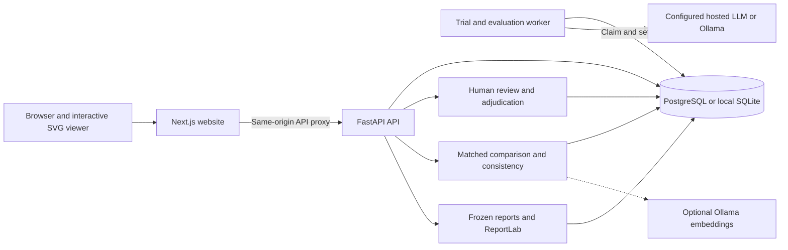
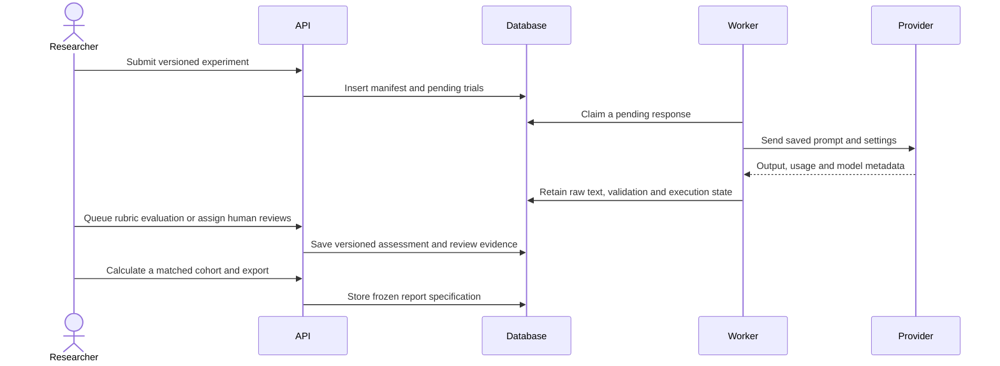

# System architecture

The browser uses one public website origin. Next.js rewrites API paths to FastAPI. The API checks the session, ownership, and mutation origin. The existing worker claims queued rows with a lease and commits provider results only when its claim still matches.

The frontend renders stored structured outputs as bounded interactive SVG and renders model text as text. The registry preserves exact model IDs. Report exports use an owner-scoped frozen specification and make CSV, JSON, and PDF from that record. Provider diagnostics store the latest catalog result and last successful lookup without persisting credentials in diagnostic rows. [Detailed schemas and API routes](architecture.md)
